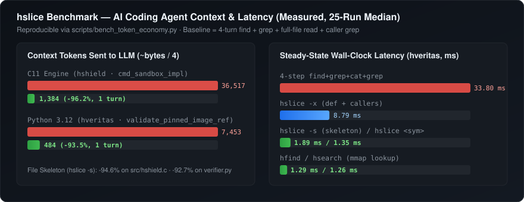

# `hslice`: Sub-2ms C11 Code Slicer & `mmap` Trigram Search for AI Coding Agents

[](https://github.com/Hephaestus-Zero/hslice/actions/workflows/ci.yml)
[](https://github.com/Hephaestus-Zero/hslice/releases/latest)
[](LICENSE)

`hslice` is a zero-dependency C11 structural code slicer and `mmap` 3-gram index engine (`hslice`, `hfind`, `hsearch`) built for **Claude Code**, **OpenAI Codex**, **Cursor**, **Gemini CLI**, and local terminal workflows. Instead of burning 4 to 6 tool turns running `find`, `grep`, and reading whole 1,000-line files into context, `hslice` extracts the exact symbol definition, enclosing traceback function, structural skeleton, or definition-plus-callers (`-x`) in **one call**, cutting context token consumption by **93% to 96%** at **~1.3 to 2.3 ms** steady-state latency.



## Audit Your Repository in One Command (`hslice --audit`)

Run `hslice --audit .` (or `hslice -A [dir]`) inside any C, C++, Rust, Go, Python, TypeScript, JavaScript, or Java repository to measure exact full-file read tokens versus structural symbol-slice tokens across your codebase:

```text
$ hslice --audit .
hslice audit  hslice (7 files, 105 symbols)
──────────────────────────────────────────────────────────────────────────────
symbol                    location                   file tok slice tok  saved
──────────────────────────────────────────────────────────────────────────────
main                      src/hfind.c:945              11,029     2,738  75.2%
run_audit_mode            src/hslice.c:1057            13,325     2,124  84.1%
main                      src/hslice.c:1292            13,325     1,953  85.3%
extract_symbol_on_line    src/hfind.c:421              11,029     1,578  85.7%
compute_symbol_bounds     src/hslice.c:170             13,325     1,425  89.3%
build_sym_index           src/hfind.c:714              11,029       958  91.3%
find_symbols              src/hslice.c:502             13,325       952  92.9%
build_path_index          src/hfind.c:258              11,029       864  92.2%
──────────────────────────────────────────────────────────────────────────────
sample (top 8 largest functions)                       97,416    12,592  87.1%
all 105 indexed symbols                               926,685    33,862  96.3%
──────────────────────────────────────────────────────────────────────────────
context saved: 96.3%  ·  density: 27.4x  ·  elapsed: 1.4 ms
github.com/Hephaestus-Zero/hslice
```



## Quick Install

- **Homebrew (macOS Apple Silicon & Linux):**
  ```bash
  brew install Hephaestus-Zero/tap/hslice
  ```
- **Agent Skill (Claude Code, Cursor, Codex, Antigravity):**
  ```bash
  npx skills add Hephaestus-Zero/hslice
  ```
- **Claude Code Plugin:**
  ```text
  /plugin marketplace add Hephaestus-Zero/hslice
  ```
- **Python / `pip` / `uvx`:**
  ```bash
  pip install git+https://github.com/Hephaestus-Zero/hslice.git
  ```
- **Prebuilt Binary (`x86_64` Linux & `arm64` macOS):**
  ```bash
  curl -fsSL https://raw.githubusercontent.com/Hephaestus-Zero/hslice/main/install.sh | sh
  ```

## Why Agents Waste Tokens (And How `hslice` Fixes It)

Standard agent code exploration takes four round-trips and floods the context window:
1. Locate the file (`find` / glob)
2. Locate the line (`grep def ...`)
3. Read the entire source file (`read_file` / `cat`)
4. Find callers (`grep -rnw ...`)

`hslice` collapses all four into one deterministic command:

```bash
# 1. Single-shot recon: exact definition body + all bounded references in 1 call
hslice -x cmd_sandbox_impl

# 2. Extract exact function / class / struct by symbol name (~1.3 to 2.0 ms)
hslice validate_pinned_image_ref

# 3. Traceback / stack-trace zoom: pass file:line to extract ONLY its enclosing function
hslice src/hveritas/repository/verifier.py:452

# 4. Compact structural skeleton (~92% to 95% fewer tokens than reading the file)
hslice -s src/hshield.c

# 5. Repository token-savings audit receipt (< 10 ms on typical repos)
hslice --audit .

# 6. Zero-copy mmap path & symbol trigram lookup (~1.3 ms) or bounded regex body search
hfind verifier.py
hsearch run_pytest
hsearch -g "LANDLOCK_ACCESS_NET"
```

<details>
<summary>Example output of <code>hslice -s src/hveritas/repository/verifier.py</code> (32 lines instead of 848)</summary>

```text
=== SKELETON src/hveritas/repository/verifier.py (848 lines) ===
     3: from __future__ import annotations
     ...
SYMBOLS (27):
    35-45   [fn] def _norm(nodeid: str) -> str:
    48-159  [fn] def _make_plugin(pipe_fd: int):
    53-157  [class] class _VerifierPlugin:
   286-303  [fn] def validate_pinned_image_ref(image_digest: str) -> str:
   396-590  [class] class DockerRepositoryVerifier:
   415-484  [fn] def build_command(
   495-577  [fn] def run_pytest(
   599-848  [fn] def parse_container_output(
```

</details>

## Zero-Daemon Lazy Freshness (`stat().st_mtime > built_epoch`)

Coding agents edit files mid-session, shifting line numbers below each edit. Instead of running a background `inotify` / FSEvents daemon or requiring git hooks, `hslice` stores `built_epoch` inside the `hsym.idx` header and checks `stat().st_mtime > idx->built_epoch` on matched files at query time:

- **Steady state (unchanged file):** One `stat()` syscall (~1 microsecond) confirms the matched file has not been modified since `built_epoch`. Zero rebuild overhead.
- **After an edit or file move:** When a matched file is missing or has `st_mtime > built_epoch` (or when a newly added symbol is queried after a workspace edit), `hslice` runs a single-shot index rebuild in single-digit milliseconds and re-resolves exact line bounds automatically, without passing `-r`.

## Measured Benchmark (Linux `x86_64`, 25-Run Median)

Measured directly with [`scripts/bench_token_economy.py`](scripts/bench_token_economy.py) against live C11 (`hshield`) and Python (`hveritas`) repositories:

| Repository & Target | Baseline 4-Step (`find+grep+cat+grep`) | `hslice -x` (1-Shot Def + Refs) | Token Reduction | `hfind` / `hsearch` | `hslice -s` Skeleton vs `cat` |
|---|---:|---:|---:|---:|---:|
| **`hshield`** (`C11`, `cmd_sandbox_impl`) | 12.83 ms · ~36,517 tok (4 turns) | **7.68 ms · ~1,384 tok** (1 turn) | **-96.2%** | 1.68 ms / 1.74 ms | 2.26 ms · ~1,955 tok (**-94.6%**) |
| **`hveritas`** (`Python`, `validate_pinned_image_ref`) | 33.80 ms · ~7,453 tok (4 turns) | **8.79 ms · ~484 tok** (1 turn) | **-93.5%** | 1.29 ms / 1.26 ms | 1.89 ms · ~515 tok (**-92.7%**) |

Run the benchmark on any local repository yourself:

```bash
python3 scripts/bench_token_economy.py \
  --repo /path/to/repo \
  --symbol MySymbol \
  --file-hint '*.py' \
  --target-file path/to/file.py
```

## Installation

### Option A: Prebuilt Binary Installer (Linux `x86_64` & macOS `arm64`, falls back to source build)

```bash
curl -fsSL https://raw.githubusercontent.com/Hephaestus-Zero/hslice/main/install.sh | sh
```

### Option B: Build from Source (`cc` only, zero external libraries)

```bash
git clone https://github.com/Hephaestus-Zero/hslice.git
cd hslice
make
make test
sudo make install   # or: make install PREFIX="$HOME/.local"
```

### Option C: `pip` / `uvx` CLI Package

```bash
pip install git+https://github.com/Hephaestus-Zero/hslice.git
# or run ephemerally via uvx (requires C compiler on host):
uvx --from git+https://github.com/Hephaestus-Zero/hslice.git hslice --audit .
```

### Option D: GitHub Actions

```yaml
- uses: Hephaestus-Zero/hslice@v0.2.0
```

## Coding-Agent Drop-In Setup

Drop [`integrations/SKILL.md`](integrations/SKILL.md) into your Claude Code / Codex / Cursor skill folder, or copy [`integrations/CLAUDE.md`](integrations/CLAUDE.md) into your project's `CLAUDE.md` / `AGENTS.md`:

```bash
mkdir -p ~/.claude/skills/hslice
curl -fsSL https://raw.githubusercontent.com/Hephaestus-Zero/hslice/main/integrations/SKILL.md \
  -o ~/.claude/skills/hslice/SKILL.md
```

## Architecture & Language Support

- **Two-Pass Counting-Sort `mmap` 3-Gram Index:** `hfind` and `hsearch` pack 6-bit character trigrams into `262,144` direct-mapped buckets (`O(N)` build, galloping sorted posting-list intersection at query time), mapped directly via `mmap(PROT_READ)`.
- **Zero-Daemon Lazy Freshness:** Checks `stat().st_mtime > built_epoch` on matched files and triggers a single-shot rebuild only when edited files outdate the cached `.idx`.
- **Automatic Per-Workspace Scoping:** Discovers the enclosing `.git` repository root (or `$PWD`, overridden via `--root <dir1[:dir2]>` or `HSLICE_ROOTS`), storing hashed `.idx` caches per workspace under `$HSLICE_CACHE_DIR` / `$XDG_RUNTIME_DIR/hslice` / `/tmp/hslice-<uid>` so switching repositories never leaks cross-project symbols.
- **Zero-Allocation Structural Slicer:** Language-aware boundary extraction handles Python indentation + `@decorators` + triple-quoted docstrings as well as brace-delimited C, C++, Rust, Go, JavaScript, TypeScript, and Java (ignoring braces inside comments and strings).
- **Resilient Cross-Reference Fallback:** `hslice -x` and `hsearch -g` invoke `rg` when available and fall back to POSIX `grep -rnE` on minimal Linux/macOS environments.

## Comparison with Alternatives

| Tool | Runtime / Dependencies | Lookup Speed | Lazy Index Self-Healing | Structural Body Slicing | 1-Shot Def + Callers (`-x`) |
|---|---|---|---|---|---|
| **`hslice` (`+ hfind/hsearch`)** | Single C11 binary (`libc` only) | **~1.3 to 2.0 ms** | Yes (`stat` mtime, 0 daemons) | Yes (Py, C/C++, Rust, Go, TS/JS, Java) | Yes |
| `ripgrep` + manual `read` | Rust binary + extra agent turns | 10 to 40 ms | N/A (stateless scan) | Line match only (needs full file read) | Multiple calls |
| `ctags` + `awk`/`sed` | External binary + custom scripts | 10 to 50 ms | Manual regen / git hooks | Header/tag start line only | No |
| Tree-sitter / LSP MCP | Node/Python/LSP daemon (~100+ MB RAM) | 20 to 500 ms startup | Resident background daemon | Heavy AST server | Multi-step |

## License

MIT License. Copyright (c) 2026 Hephaestus-Zero.
